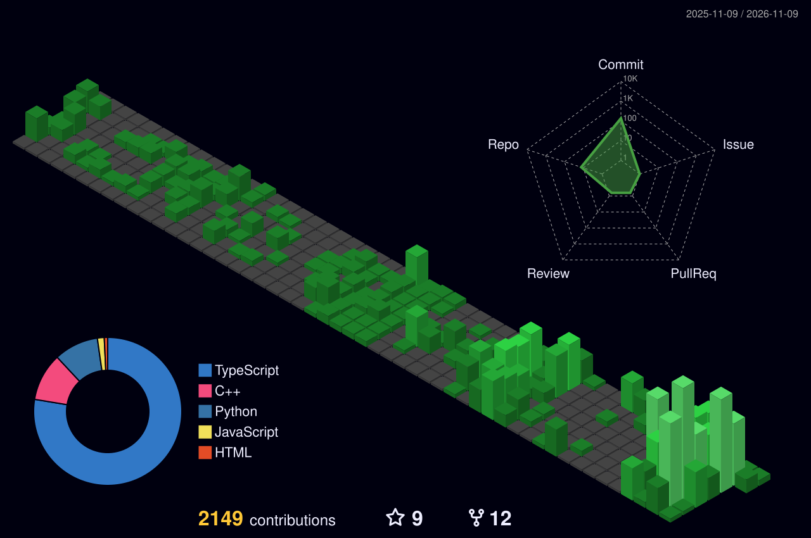

  

  

  

  
  

  

<!-- CHESS:START -->

### ♟️ Play chess with me

**It's your turn (White).** Click a move below, then press **Submit new issue**. The bot answers in about a minute and this board updates itself.

| Piece | Move to |
| :-- | :-- |
| ♔ King e1 | [e2](https://github.com/afrizalyogi/afrizalyogi/issues/new?title=chess%7Cmove%7Ce1e2&body=Just%20press%20Submit%20new%20issue.%20The%20board%20updates%20in%20about%20a%20minute.) |
| ♕ Queen d1 | [e2](https://github.com/afrizalyogi/afrizalyogi/issues/new?title=chess%7Cmove%7Cd1e2&body=Just%20press%20Submit%20new%20issue.%20The%20board%20updates%20in%20about%20a%20minute.) · [f3](https://github.com/afrizalyogi/afrizalyogi/issues/new?title=chess%7Cmove%7Cd1f3&body=Just%20press%20Submit%20new%20issue.%20The%20board%20updates%20in%20about%20a%20minute.) · [g4](https://github.com/afrizalyogi/afrizalyogi/issues/new?title=chess%7Cmove%7Cd1g4&body=Just%20press%20Submit%20new%20issue.%20The%20board%20updates%20in%20about%20a%20minute.) · [h5](https://github.com/afrizalyogi/afrizalyogi/issues/new?title=chess%7Cmove%7Cd1h5&body=Just%20press%20Submit%20new%20issue.%20The%20board%20updates%20in%20about%20a%20minute.) |
| ♗ Bishop f1 | [e2](https://github.com/afrizalyogi/afrizalyogi/issues/new?title=chess%7Cmove%7Cf1e2&body=Just%20press%20Submit%20new%20issue.%20The%20board%20updates%20in%20about%20a%20minute.) · [d3](https://github.com/afrizalyogi/afrizalyogi/issues/new?title=chess%7Cmove%7Cf1d3&body=Just%20press%20Submit%20new%20issue.%20The%20board%20updates%20in%20about%20a%20minute.) · [c4](https://github.com/afrizalyogi/afrizalyogi/issues/new?title=chess%7Cmove%7Cf1c4&body=Just%20press%20Submit%20new%20issue.%20The%20board%20updates%20in%20about%20a%20minute.) · [b5](https://github.com/afrizalyogi/afrizalyogi/issues/new?title=chess%7Cmove%7Cf1b5&body=Just%20press%20Submit%20new%20issue.%20The%20board%20updates%20in%20about%20a%20minute.) · [a6](https://github.com/afrizalyogi/afrizalyogi/issues/new?title=chess%7Cmove%7Cf1a6&body=Just%20press%20Submit%20new%20issue.%20The%20board%20updates%20in%20about%20a%20minute.) |
| ♘ Knight b1 | [a3](https://github.com/afrizalyogi/afrizalyogi/issues/new?title=chess%7Cmove%7Cb1a3&body=Just%20press%20Submit%20new%20issue.%20The%20board%20updates%20in%20about%20a%20minute.) · [c3](https://github.com/afrizalyogi/afrizalyogi/issues/new?title=chess%7Cmove%7Cb1c3&body=Just%20press%20Submit%20new%20issue.%20The%20board%20updates%20in%20about%20a%20minute.) |
| ♘ Knight g1 | [e2](https://github.com/afrizalyogi/afrizalyogi/issues/new?title=chess%7Cmove%7Cg1e2&body=Just%20press%20Submit%20new%20issue.%20The%20board%20updates%20in%20about%20a%20minute.) · [f3](https://github.com/afrizalyogi/afrizalyogi/issues/new?title=chess%7Cmove%7Cg1f3&body=Just%20press%20Submit%20new%20issue.%20The%20board%20updates%20in%20about%20a%20minute.) · [h3](https://github.com/afrizalyogi/afrizalyogi/issues/new?title=chess%7Cmove%7Cg1h3&body=Just%20press%20Submit%20new%20issue.%20The%20board%20updates%20in%20about%20a%20minute.) |
| ♙ Pawn a2 | [a3](https://github.com/afrizalyogi/afrizalyogi/issues/new?title=chess%7Cmove%7Ca2a3&body=Just%20press%20Submit%20new%20issue.%20The%20board%20updates%20in%20about%20a%20minute.) · [a4](https://github.com/afrizalyogi/afrizalyogi/issues/new?title=chess%7Cmove%7Ca2a4&body=Just%20press%20Submit%20new%20issue.%20The%20board%20updates%20in%20about%20a%20minute.) |
| ♙ Pawn b2 | [b3](https://github.com/afrizalyogi/afrizalyogi/issues/new?title=chess%7Cmove%7Cb2b3&body=Just%20press%20Submit%20new%20issue.%20The%20board%20updates%20in%20about%20a%20minute.) · [b4](https://github.com/afrizalyogi/afrizalyogi/issues/new?title=chess%7Cmove%7Cb2b4&body=Just%20press%20Submit%20new%20issue.%20The%20board%20updates%20in%20about%20a%20minute.) |
| ♙ Pawn c2 | [c3](https://github.com/afrizalyogi/afrizalyogi/issues/new?title=chess%7Cmove%7Cc2c3&body=Just%20press%20Submit%20new%20issue.%20The%20board%20updates%20in%20about%20a%20minute.) · [c4](https://github.com/afrizalyogi/afrizalyogi/issues/new?title=chess%7Cmove%7Cc2c4&body=Just%20press%20Submit%20new%20issue.%20The%20board%20updates%20in%20about%20a%20minute.) |
| ♙ Pawn d2 | [d3](https://github.com/afrizalyogi/afrizalyogi/issues/new?title=chess%7Cmove%7Cd2d3&body=Just%20press%20Submit%20new%20issue.%20The%20board%20updates%20in%20about%20a%20minute.) · [d4](https://github.com/afrizalyogi/afrizalyogi/issues/new?title=chess%7Cmove%7Cd2d4&body=Just%20press%20Submit%20new%20issue.%20The%20board%20updates%20in%20about%20a%20minute.) |
| ♙ Pawn e4 | [d5](https://github.com/afrizalyogi/afrizalyogi/issues/new?title=chess%7Cmove%7Ce4d5&body=Just%20press%20Submit%20new%20issue.%20The%20board%20updates%20in%20about%20a%20minute.) · [e5](https://github.com/afrizalyogi/afrizalyogi/issues/new?title=chess%7Cmove%7Ce4e5&body=Just%20press%20Submit%20new%20issue.%20The%20board%20updates%20in%20about%20a%20minute.) |
| ♙ Pawn f2 | [f3](https://github.com/afrizalyogi/afrizalyogi/issues/new?title=chess%7Cmove%7Cf2f3&body=Just%20press%20Submit%20new%20issue.%20The%20board%20updates%20in%20about%20a%20minute.) · [f4](https://github.com/afrizalyogi/afrizalyogi/issues/new?title=chess%7Cmove%7Cf2f4&body=Just%20press%20Submit%20new%20issue.%20The%20board%20updates%20in%20about%20a%20minute.) |
| ♙ Pawn g2 | [g3](https://github.com/afrizalyogi/afrizalyogi/issues/new?title=chess%7Cmove%7Cg2g3&body=Just%20press%20Submit%20new%20issue.%20The%20board%20updates%20in%20about%20a%20minute.) · [g4](https://github.com/afrizalyogi/afrizalyogi/issues/new?title=chess%7Cmove%7Cg2g4&body=Just%20press%20Submit%20new%20issue.%20The%20board%20updates%20in%20about%20a%20minute.) |
| ♙ Pawn h2 | [h3](https://github.com/afrizalyogi/afrizalyogi/issues/new?title=chess%7Cmove%7Ch2h3&body=Just%20press%20Submit%20new%20issue.%20The%20board%20updates%20in%20about%20a%20minute.) · [h4](https://github.com/afrizalyogi/afrizalyogi/issues/new?title=chess%7Cmove%7Ch2h4&body=Just%20press%20Submit%20new%20issue.%20The%20board%20updates%20in%20about%20a%20minute.) |

**Top players:** [@afrizalyogi](https://github.com/afrizalyogi) (1)

<!-- CHESS:END -->

<b>Watch a classic:</b> The Opera Game, Morphy 1858

 

  

  <samp>
    <a href="https://afrizalyogi.my.id">website</a> ·
    <a href="mailto:afrizalyogi@aycorp.id">email</a> ·
    <a href="https://linkedin.com/in/afrizalyogi">linkedin</a> ·
    <a href="https://instagram.com/afrizalyogi.co">instagram</a>
  </samp>

