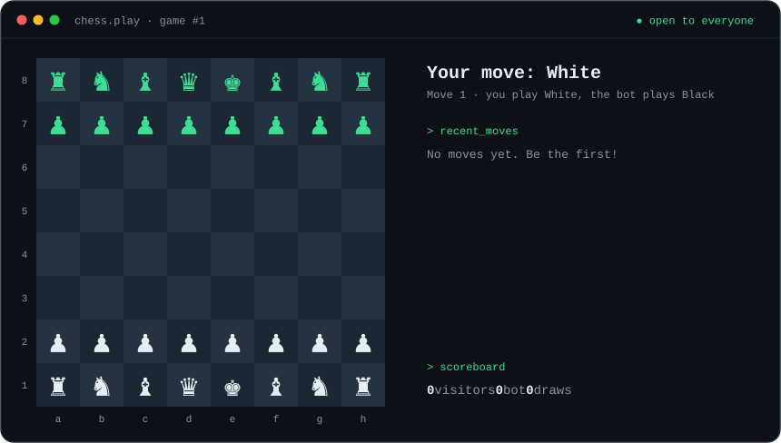

  

  

  

  

  

  

  

  <samp>
    <a href="https://afrizalyogi.my.id">website</a> ·
    <a href="mailto:afrizalyogi@aycorp.id">email</a> ·
    <a href="https://linkedin.com/in/afrizalyogi">linkedin</a> ·
    <a href="https://instagram.com/afrizalyogi.co">instagram</a>
  </samp>

